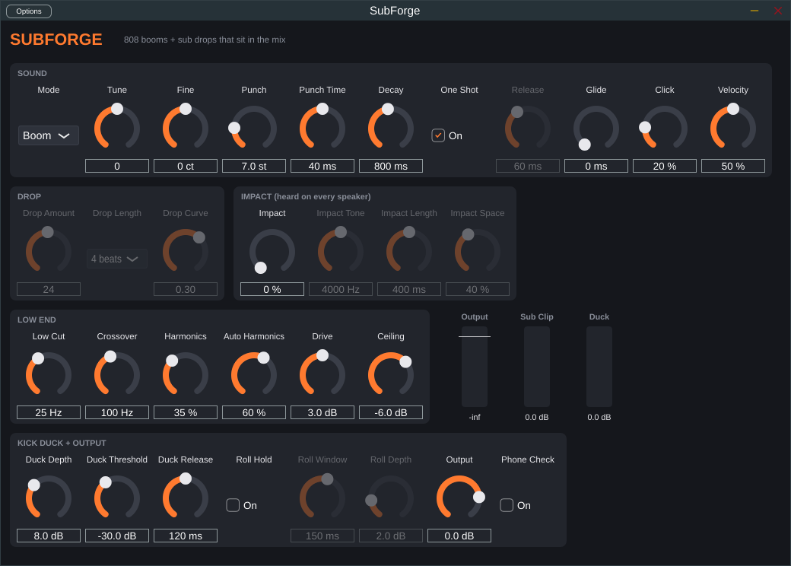
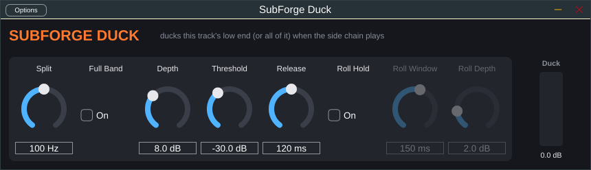

# SubForge

An 808 boom and sub drop instrument for Logic Pro, built so the low end fits the
mix: it doesn't blow out the bottom, and it stays audible on small speakers.



## Why it doesn't blow out the mix

Most sub drops cause trouble for the same reasons: a pure low sine eats all the
headroom, it gets quieter to the ear as it falls (so you turn it up), it vanishes
on phones, and its peaks stack with the kick. SubForge handles each of these:

| Problem | What SubForge does |
| --- | --- |
| Energy below ~25 Hz uses up headroom nobody hears | **Low Cut**: a steep 24 dB/oct high-pass removes it |
| Sub peaks push the master limiter into distortion | **Drive + Ceiling**: the sub is soft-clipped up to a fixed ceiling, so its peak level is predictable |
| Drop disappears on phones and laptops | **Harmonics**: an audible harmonic layer above the **Crossover** lets your ear "hear" the missing fundamental |
| Drop sounds quieter as it falls, so you push it | **Auto Harmonics**: more harmonics are added the lower the pitch goes, instead of more level |
| Kick and sub peaks stack | **Kick Duck**: route the kick into the side chain and the sub dips out of its way |
| Wide sub collapses on mono systems and clubs | Output is always mono |
| Retriggered 808s click | New notes choke the old one with a 5 ms fade and always start at the same point in the wave |

Because SubForge makes the sound itself, it knows the exact pitch at every moment.
The harmonics come straight from that pitch, so they're clean (no aliasing) and
follow a drop perfectly, with no pitch detection guesswork.

## Two modes

- **Boom**: an 808-style hit. It starts **Punch** semitones above the note and
  settles onto it over **Punch Time**, then rings out over **Decay**. With
  **One Shot** on it rings out fully; turn it off to let note length (plus
  **Release**) gate it. **Glide** slides between overlapping notes.
- **Drop**: a sub sweep. It falls **Drop Amount** semitones from the note you
  play, over **Drop Length** (synced to the song tempo), shaped by **Drop
  Curve** (negative = fast start, positive = slow start then plunge). Use 12, 24
  or 36 semitones to land on the same note an octave or more lower, so it ends in key.

## Impact layer

A sub on its own is felt, not heard. On records, a hit also has a "heard" layer
on top. **Impact** adds one, fired with every new note so it always lines up
with the boom:

- **Impact**: level of the layer (0 = off).
- **Tone**: how bright the noise burst is (dark around 1–2 kHz, crashy 8–12 kHz).
- **Length**: how long the burst lasts.
- **Space**: how much room tail it gets. The tail is in stereo, so the hit
  sounds wide while the sub stays mono and centered.

The layer is kept above 150 Hz, so it never adds to the low end, and the kick
duck leaves it alone. It's on in **Impact Boom**, **Metal Breakdown Boom** and
**Impact Drop** and **Classic Drop**.

## Making hits feel big (breakdown recipe)

1. **Gap:** stop the guitars and bass a 16th or 8th before the hit. A hit after
   silence feels huge; a hit under a wall of guitars doesn't.
2. **Lead-in:** a reversed cymbal or riser over the bar before, ending on the hit.
3. **Hit:** SubForge (**Metal Breakdown Boom**, Impact on) on your low root,
   plus a crash. Pull the SubForge note 10–20 ms after the kick, or set Duck
   Depth to 2–3 dB, so the kick doesn't duck the boom's own attack.
4. **Mix dip:** put **SubForge Duck** on the guitar or music bus, turn on
   **Full Band**, side chain it to SubForge, Depth 3 dB, Release about 200 ms.
   The band dips for a moment on each hit, so the hit sounds louder without the
   master getting louder.
5. **Bass:** another **SubForge Duck** on the bass (Full Band off, Split about
   100 Hz), side chained to SubForge.
6. **Level:** set the boom so the master limiter grabs no more than 2–3 dB.

## Presets

Pick these from the preset menu at the top of the SubForge window in Logic.

| Preset | What it is | How to play it |
| --- | --- | --- |
| **Default** | Punchy, slightly driven 808 | Any short note |
| **Long 30 Hz Boom** | Matched to a reference track: dives from ~120 Hz to 30 Hz, barely decays | Play **B-1**; the note length sets how long it rings (Fine is at -49 cents to hit exactly 30 Hz) |
| **Trap 808 Slide** | Melodic 808 for basslines | Note length matters; overlap notes to slide between them |
| **Short Punchy 808** | Short, bouncy, hard attack | Fast patterns |
| **Distorted 808** | Gritty and saturated, cuts through busy mixes | Any note |
| **Clean Sine Sub** | Pure deep sub, no dirt | Sparse mixes, big systems |
| **Phone-Safe 808** | Extra harmonics so it reads on phones and laptops | Any note |
| **Impact Boom** | One big cinematic hit with a deep pitch dive | Single hits on downbeats |
| **Metal Breakdown Boom** | Deep boom for dense metal mixes, with Roll Hold on so it survives double kick | Play your low root (B-1 for B tuning); route the kick into the side chain |
| **Sub Layer (Sustained)** | Clean, steady sub under open chords and big sections | Follow the bass root notes; note length sets how long it sounds |
| **Sub Layer (Chugs)** | Tight sub that doubles palm-muted chugs | Copy the chug rhythm on the root note. For fast chugs, play it an octave up (e.g. B0 instead of B-1): a 30 Hz wave needs 33 ms per cycle, so very low chugs can't stop and start cleanly |
| **Classic Drop (1 bar)** | The classic metal sub drop: hits, then falls two octaves over the bar | Play it **on** the downbeat of the section |
| **Long Drop (2 bars)** | Lead-in drop: hangs at the top, then plunges into the section | Start two bars **before** the downbeat so it lands on it |
| **Quick Dive (1 beat)** | One octave in one beat | Fills |
| **Impact Drop (2 beats)** | Hard attack that sinks fast, then rumbles out | Transitions |

Every preset keeps its peak at or under the Ceiling (-6 dB, or -4 dB for Long 30 Hz Boom).

## Building and installing in Logic (Mac)

You need Xcode (from the App Store) and CMake (`brew install cmake`).

```sh
git clone https://github.com/bobrobertsonson/git_practice.git
cd git_practice
git checkout claude/peaceful-goldberg-oil95u
cmake -B build -G Xcode -DCMAKE_OSX_ARCHITECTURES="arm64;x86_64"
cmake --build build --config Release --target SubForge_AU
cmake --build build --config Release --target SubForgeDuck_AU
```

The first configure downloads JUCE, so it takes a minute. The build copies
`SubForge.component` into `~/Library/Audio/Plug-Ins/Components`. Check that macOS
accepts it:

```sh
auval -v aumu Sfg1 Sbfg
auval -v aufx Sfd1 Sbfg
```

Then open Logic. If it doesn't show up, use **Logic Pro → Settings → Plug-in
Manager → Reset & Rescan Selection**. Create a **Software Instrument** track and
choose **AU Instruments → SubForge → SubForge**.

## Fitting it into a mix

1. **Play in key.** The pitch comes from the MIDI note. For drops, pick a Drop
   Amount of 12/24/36 so they land on the root.
2. **Set the Ceiling first** (the default is -6 dB). It caps SubForge's peak
   level, so the rest of the mix keeps its headroom. The line on the Output meter
   shows it. Use **Output** to trim afterwards.
3. **Drive** adds weight. Watch the **Sub Clip** meter: a few dB of reduction is
   fine, constant 10+ dB is crunchy.
4. **Route the kick into the side chain.** In the SubForge window header, open
   the **Side Chain** menu and pick your kick track or bus. Set **Duck Threshold**
   so the **Duck** meter moves on every kick, then **Duck Depth** to taste (6–10 dB)
   and **Duck Release** so it recovers before the next note. Only the kick's low
   end triggers it, so hats and claps on the same bus won't. If Logic doesn't offer
   a side chain menu for the instrument, use Logic's Compressor on the SubForge
   track with the kick as its side chain instead.

   **Double kick:** turn on **Roll Hold**. The first kick of a run still ducks
   fully, but once kicks come closer together than **Roll Window** (150 ms
   catches 16ths down to about 100 BPM), SubForge stops ducking on every hit
   and holds a steady **Roll Depth** (2 dB) until the run ends. Without it, a
   fast kick run either buries the sub for the whole run or makes it pump.
5. **Make room under drops.** Put a Compressor on your bass track with SubForge
   as its side chain, or simply cut or thin the bass while a drop plays.
6. **Turn on Phone Check** to hear roughly what a phone speaker plays (everything
   below 150 Hz removed). If the drop disappears, raise **Harmonics** or **Auto
   Harmonics**, not the level. **Turn it off before you bounce.**

## Controls

| Section | Control | Range | Default |
| --- | --- | --- | --- |
| Sound | Mode | Boom / Drop | Boom |
| | Tune / Fine | ±24 st / ±100 cents | 0 / 0 |
| | Punch / Punch Time | 0–36 st / 5–150 ms | 7 st / 40 ms |
| | Decay | 50–12000 ms (time to fall 60 dB) | 800 ms |
| | One Shot / Release | on/off / 5–2000 ms | on / 60 ms |
| | Glide | 0–500 ms | 0 |
| | Click | 0–100 % | 20 % |
| | Velocity | 0–100 % sensitivity | 50 % |
| Drop | Drop Amount | 1–48 st | 24 |
| | Drop Length | 1/4 to 16 beats | 4 beats |
| | Drop Curve | -1 to +1 | 0.3 |
| Low End | Low Cut | 15–60 Hz | 25 Hz |
| | Crossover | 60–200 Hz | 100 Hz |
| | Harmonics / Auto Harmonics | 0–100 % | 35 % / 60 % |
| | Drive | -12 to +18 dB (negative keeps the sub clean under the ceiling) | 3 dB |
| | Ceiling | -18 to 0 dBFS | -6 dBFS |
| Impact | Impact / Tone / Length / Space | 0–100 % / 1–12 kHz / 50–2000 ms / 0–100 % | 0 % (off) / 4 kHz / 400 ms / 40 % |
| Kick Duck + Output | Duck Depth / Threshold / Release | 0–24 dB / -48–0 dB / 20–500 ms | 8 dB / -30 dB / 120 ms |
| | Roll Hold / Roll Window / Roll Depth | on/off / 60–250 ms / 0–12 dB | off / 150 ms / 2 dB |
| | Output | -24 to +6 dB (after the ceiling) | 0 dB |
| | Phone Check | on/off, monitoring only | off |

## SubForge Duck (for the bass track)



A small effect that makes room for SubForge in the bass. It splits the bass at
**Split** and turns down only the part below it while the side chain plays; the
grit above the split is never touched. With nothing ducking it is transparent:
the two halves add back up to the original bass.

1. On the bass track, add **Audio FX → Audio Units → SubForge → SubForge Duck**.
2. In its header, set **Side Chain** to your SubForge track.
3. Play a boom and lower **Threshold** until **Low Duck** shows about the
   **Depth** (start with 6–8 dB). Set **Release** so the bass comes back right
   after the boom.
4. Raise **Split** if the bass still fights the boom, lower it if the bass loses
   too much weight.

It also works keyed by the kick, with the same **Roll Hold** as SubForge for
double kick.

**Full Band** ducks the whole track instead of only below Split. Use it on the
guitar or music bus, keyed by SubForge, so the band dips for a moment on each
hit (Depth 2–4 dB, Release about 200 ms).

## Signal flow

```
            ┌─ sub ──────── low cut ─ drive ─ soft clip (ceiling) ─┐
MIDI ─ voice┼─ harmonics ── high-pass at crossover ────────────────┼─ kick duck ─ safety clip (ceiling) ─ output ─ [phone check]
            └─ click ──────────────────────────────────────────────┘
```

## Project layout

- `Source/dsp/`: the sound engine (plain C++, no JUCE): `SubVoice.h` makes
  the boom/drop, `SubEngine.h` handles notes and the low-end chain, `Filters.h`
  has the filters and the soft clipper.
- `Source/plugin/`: the JUCE wrapper: parameters, MIDI, side chain and the control panel.
- `tests/dsp_tests.cpp`: offline tests for ceiling, pitch accuracy, tempo sync,
  harmonics, click-free retriggering, low cut, ducking, gating and glide.

## Developing on any OS

The DSP tests and the VST3/Standalone builds work on macOS, Linux and Windows:

```sh
cmake -B build -DCMAKE_BUILD_TYPE=Release
cmake --build build
ctest --test-dir build                         # run the DSP tests
./build/subforge_tests /some/folder            # also write demo WAV renders
```

Use `-DSUBFORGE_BUILD_PLUGIN=OFF` to build only the tests (no JUCE download).
